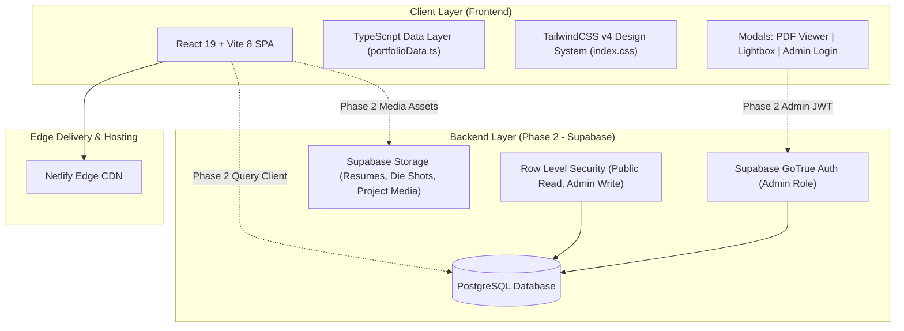

# Architecture Specification & Engineering Portfolio Blueprint
**Portfolio Owner:** VIJAYARAGAVAA V — Aspiring RTL Design & Verification Engineer  
**Core Disciplines:** Electronics & Communication Engineering, VLSI, RTL Design (Verilog HDL/SystemVerilog), FPGA, Digital Design, Verification, IoT, AI + Hardware Systems  

---

## 1. High-Level System Architecture



---

## 2. Directory Structure & Module Separation

The repository is structured to maintain clean separation between the presentation tier, backend infrastructure, and migration tooling:

```
d:\prot\
├── ARCHITECTURE.md              # Complete system design & execution roadmap
├── .gitignore                   # Workspace Git ignore definitions
├── netlify.toml                 # Builds frontend/ and configures the SPA rewrite
├── backend/                     # Supabase SQL schemas, migrations & backend reference
│   ├── README.md                # Backend architecture & Supabase onboarding guide
│   └── schema.sql               # PostgreSQL DDL schema & RLS policies
├── tools/                       # Tooling & migration archive
│   └── migration/               # Seed extraction scripts and original reference assets
└── frontend/                    # React 19 + Vite + TailwindCSS v4 SPA
    ├── index.html               # Semantic HTML entry with JetBrains Mono + Space Grotesk
    ├── vite.config.ts           # Vite config with @tailwindcss/vite and @vitejs/plugin-react
    ├── package.json             # React 19, Lucide React icons, TailwindCSS v4
    ├── public/                  # Public web assets (favicon, resume.pdf, redirects)
    ├── supabase/                # Versioned SQL migrations (001 - 007)
    ├── docs/                    # Administrative and setup documentation
    └── src/
        ├── main.tsx             # Application bootstrap & React Router configuration
        ├── App.tsx              # View orchestrator, modal state management, sticky navigation
        ├── index.css            # Tailwind v4 theme tokens, semiconductor grid, cyan glow effects
        ├── types/               # TypeScript interfaces (portfolio.ts, database.ts)
        ├── data/                # Strongly-typed portfolio fallback models (portfolioData.ts)
        ├── assets/              # Profile portraits, silicon die shots, FPGA prototype imagery
        ├── lib/                 # Supabase client instantiation
        ├── hooks/               # Custom React hooks (usePortfolioData, useAdminCRUD)
        ├── services/            # Supabase API services for CRUD operations
        ├── pages/               # Protected Admin Dashboard & Management pages
        └── components/          # Modular semiconductor-styled UI components
            ├── Header.tsx       # Sticky glassmorphic navigation header
            ├── Hero.tsx         # 3-column command center: bio, portrait, EDA toolchain
            ├── About.tsx        # Engineering philosophy, dossier specs, VLSI profile
            ├── Skills.tsx       # 6-category capability matrix (RTL, FPGA, Verification, etc.)
            ├── Projects.tsx     # Hardware designs (PARKIFY, Voting Machine, Smart Lift)
            ├── Hackathons.tsx   # Hardware prototype showcase with telemetry metrics
            ├── Achievements.tsx # IEEE, national hackathon honors, university badges
            ├── Certifications.tsx # Industry credentials (IEEE, Xilinx, NPTEL)
            ├── Education.tsx    # Academic journey & coursework at RMKCET
            ├── Experience.tsx   # Research lab & hardware engineering responsibilities
            ├── Gallery.tsx      # High-res hardware lab, FPGA boards, die shots
            ├── Contact.tsx      # Dispatch form & direct social communication channels
            ├── Resume.tsx       # Curriculum Vitae viewer & PDF download trigger
            ├── Footer.tsx       # System telemetry, copyright, and discreet Admin Login trigger
            ├── VChipExperience.tsx # 3.5s 3D semiconductor loader & permanent floating V-chip
            ├── DocumentViewer.tsx # Interactive modal PDF viewer
            ├── ImageLightbox.tsx  # High-resolution modal lightbox for image inspection
            ├── SectionHeader.tsx  # Reusable semiconductor-themed section header
            └── admin/           # Admin layout, sidebar, tables, and form fields
```

---

## 3. Visual Design System Specification

| Token / Element | Value / Rule | Description |
| :--- | :--- | :--- |
| **Primary Background** | `#030609` | Deep space black / obsidian vacuum |
| **Card Surface** | `#07111f` | Dark silicon slate with subtle cyan boundary lines |
| **Card Border** | `#10304d` | Subdued circuit trace border |
| **Primary Accent** | `#00d9ff` | Electric Cyan (glows, badges, buttons, active states) |
| **Secondary Accent** | `#a78bfa` | Electric Violet (verification & academic markers) |
| **Success / Valid** | `#34d399` | Hardware green (timing closure, simulation passed) |
| **Warning / Alert** | `#fbbf24` | Amber (critical clocks, synthesis constraints) |
| **Body Typography** | `Space Grotesk` | Modern, clean, geometric sans-serif for readability |
| **Tech / Code Typography** | `JetBrains Mono` | High-precision monospace for telemetry, addresses, registers |
| **Grid Overlay** | `.tech-grid` | 32px x 32px subtle semiconductor circuit grid pattern |

---

## 4. Phase 1 vs. Phase 2 Execution Plan

### Phase 1: Standalone Frontend Website (COMPLETED & VERIFIED)
- [x] Full UI match against Google Stitch reference design.
- [x] All 12 required portfolio sections implemented with authentic engineering data.
- [x] Interactive modals:
  - Document Viewer (PDF Resume modal).
  - Image Lightbox (Lab & FPGA board gallery inspection).
  - Admin Login modal stub with clear Phase 2 connectivity indicators.
- [x] Zero build errors with `tsc -b && vite build` (Verified).
- [x] Live Vite dev server running on `http://localhost:5173/`.

### Phase 2: Full-Stack Integration & CMS (UPCOMING)
1. **Supabase Database Setup:**
   - Deploy PostgreSQL database with tables: `projects`, `skills`, `achievements`, `certifications`, `gallery_items`, `contact_messages`.
   - Implement Row Level Security (RLS): Public can `SELECT`, authenticated admin can `INSERT`, `UPDATE`, `DELETE`.
2. **Supabase Storage:**
   - Bucket `portfolio-media`: Images, die shots, schematics, resumes.
3. **Admin CMS Dashboard:**
   - Authenticated route `/admin` with edit/add/delete forms for projects, metrics, and resume uploads.
4. **CI/CD & Deployment:**
   - Push to GitHub repository.
   - Continuous deployment on Netlify with custom domain and SSL.
