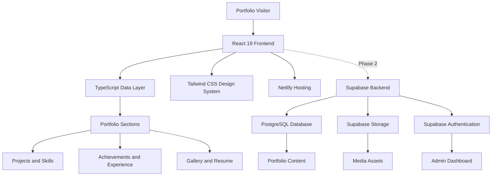
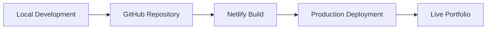

# ⚡ Vijayaragavaa V | Engineering Portfolio

<p align="center">
  
</p>

<p align="center">
  <strong>Aspiring RTL Design & Design Verification Engineer</strong>
  <br/>
  Exploring the intersection of VLSI, Digital Electronics, FPGA, Embedded Systems, IoT and AI.
</p>

<p align="center">
  <a href="https://vijayaragavaa-protfolio.netlify.app/">
    
  </a>
  <a href="https://github.com/vijayaragavaav07-VLSI">
    
  </a>
  <a href="https://www.linkedin.com/in/vijayaragavaa057-vlsi/">
    
  </a>
</p>

---

## 👨‍💻 About the Project

Welcome to my personal engineering portfolio!

This repository contains the source code for my interactive engineering portfolio, designed to showcase my academic journey, technical skills, hardware projects, hackathon experiences, achievements and interests in semiconductor technology.

As an aspiring **RTL Design and Verification Engineer**, I am continuously developing my knowledge of digital electronics, Verilog HDL, FPGA development, SystemVerilog and hardware design.

The portfolio combines a modern web experience with a semiconductor-inspired visual identity, representing my interest in both hardware engineering and software development.

**Portfolio Owner:** Vijayaragavaa V  
**Primary Domain:** VLSI Design & Verification  
**Project Type:** Personal Engineering Portfolio  
**Deployment:** Netlify  
**Repository Status:** Phase 1 Completed | Phase 2 Planned

---

## 🚀 Live Project

| Resource | Link |
|---|---|
| Live Website | [Visit Portfolio](https://vijayaragavaa-protfolio.netlify.app/) |
| GitHub Repository | [View Source Code](https://github.com/vijayaragavaav07-VLSI/Vijayaragavaa-Protfolio) |
| GitHub Profile | [Vijayaragavaa V](https://github.com/vijayaragavaav07-VLSI) |
| LinkedIn | [Connect with Me](https://www.linkedin.com/in/vijayaragavaa057-vlsi/) |

---

## ✨ Key Features

- **Engineering Profile:** Introduction, career interests and professional overview.
- **About Me:** Academic background, engineering interests and technical journey.
- **Technical Skills:** Organized skill matrix covering VLSI, RTL, FPGA, verification, embedded systems and software.
- **Projects Showcase:** Hardware, digital design, IoT and software projects.
- **Hackathons:** Project competitions, prototypes and engineering experiences.
- **Achievements:** Academic and technical accomplishments.
- **Certifications:** Professional learning and technical credentials.
- **Education:** Academic journey and relevant coursework.
- **Experience:** Internship and practical engineering exposure.
- **Technical Gallery:** Hardware prototypes, FPGA boards and engineering images.
- **Resume Viewer:** Interactive PDF viewing and download functionality.
- **Contact Section:** Professional communication and social links.

### Interactive Experiences

- Semiconductor-inspired loading animation.
- Floating V-chip visual element.
- Sticky glassmorphic navigation.
- Interactive PDF document viewer.
- High-resolution image lightbox.
- Admin login interface prepared for future backend integration.

---

## 🧰 Technology Stack

### Frontend Development

<p>
  
  
  
  
</p>

### Hardware & Engineering

<p>
  
  
  
  
</p>

### Backend & Deployment

<p>
  
  
  
  
</p>

**Additional Tools:** VS Code, Git, GitHub, Lucide React and Google Stitch.

---

## 🏗️ System Architecture

The portfolio follows a modular frontend architecture with a planned Supabase backend for future content management.



### Architecture Layers

| Layer | Technology | Responsibility |
|---|---|---|
| Presentation | React 19 | User interface and components |
| Data | TypeScript | Structured portfolio data |
| Styling | Tailwind CSS v4 | Visual design system |
| Build | Vite 8 | Development and production builds |
| Hosting | Netlify | Website deployment |
| Database | Supabase PostgreSQL | Planned content management |
| Authentication | Supabase Auth | Planned admin authentication |
| Storage | Supabase Storage | Planned media management |

---

## 🎨 Visual Design System

The interface uses a dark semiconductor-inspired theme with electric cyan highlights.

| Design Element | Value |
|---|---|
| Background | `#030609` |
| Card Surface | `#07111f` |
| Card Border | `#10304d` |
| Primary Accent | `#00d9ff` |
| Secondary Accent | `#a78bfa` |
| Success | `#34d399` |
| Warning | `#fbbf24` |
| Primary Font | Space Grotesk |
| Monospace Font | JetBrains Mono |
| Grid Pattern | 32px × 32px |

The visual language is inspired by semiconductor fabrication environments, chip layouts, electronic circuits, engineering dashboards and EDA interfaces.

---

## 📂 Repository Structure

```text
Vijayaragavaa-Protfolio/
│
├── ARCHITECTURE.md
├── README.md
├── .gitignore
│
├── backend/
│   ├── README.md
│   └── schema.sql
│
├── tools/
│   └── migration/
│
└── frontend/
    ├── index.html
    ├── package.json
    ├── vite.config.ts
    ├── netlify.toml
    │
    ├── public/
    │   ├── favicon
    │   └── resume.pdf
    │
    ├── supabase/
    │   └── migrations/
    │
    ├── docs/
    │
    └── src/
        ├── main.tsx
        ├── App.tsx
        ├── index.css
        │
        ├── types/
        ├── data/
        ├── assets/
        ├── lib/
        ├── hooks/
        ├── services/
        ├── pages/
        │
        └── components/
            ├── Header.tsx
            ├── Hero.tsx
            ├── About.tsx
            ├── Skills.tsx
            ├── Projects.tsx
            ├── Hackathons.tsx
            ├── Achievements.tsx
            ├── Certifications.tsx
            ├── Education.tsx
            ├── Experience.tsx
            ├── Gallery.tsx
            ├── Contact.tsx
            ├── Resume.tsx
            ├── Footer.tsx
            ├── VChipExperience.tsx
            ├── DocumentViewer.tsx
            ├── ImageLightbox.tsx
            ├── SectionHeader.tsx
            │
            └── admin/
```

---

## ⚙️ Getting Started

Follow these instructions to run the project locally.

### Prerequisites

- Node.js (compatible with the installed Vite version)
- npm
- Git

### 1. Clone the Repository

```bash
git clone https://github.com/vijayaragavaav07-VLSI/Vijayaragavaa-Protfolio.git
```

### 2. Navigate to the Frontend

```bash
cd Vijayaragavaa-Protfolio/frontend
```

### 3. Install Dependencies

```bash
npm install
```

### 4. Start the Development Server

```bash
npm run dev
```

### 5. Open in Browser

```text
http://localhost:5173/
```

### 6. Build for Production

```bash
npm run build
```

### 7. Preview Production Build

```bash
npm run preview
```

---

## 📌 Development Roadmap

### Phase 1 — Frontend Development

**Status: Completed**

- [x] React-based portfolio application.
- [x] Modular component architecture.
- [x] Semiconductor-inspired UI design.
- [x] Responsive portfolio sections.
- [x] Interactive resume viewer.
- [x] Image lightbox.
- [x] Admin login interface stub.
- [x] TypeScript integration.
- [x] Production build verification.
- [x] Netlify deployment.

### Phase 2 — Backend & Content Management

**Status: Planned**

- [ ] Supabase project integration.
- [ ] PostgreSQL database configuration.
- [ ] Portfolio content management tables.
- [ ] Row Level Security implementation.
- [ ] Admin authentication.
- [ ] Protected admin dashboard.
- [ ] Project and achievement CRUD operations.
- [ ] Resume and image uploads through Supabase Storage.
- [ ] Contact message management.

### Phase 3 — Future Enhancements

- [ ] Advanced project filtering.
- [ ] Technical blog and engineering notes.
- [ ] FPGA simulation and RTL project demonstrations.
- [ ] SystemVerilog verification project showcase.
- [ ] Improved performance and accessibility.
- [ ] Automated deployment and quality checks.

---

## 🚀 Deployment

The frontend is deployed using Netlify.

**Live Website:**  
https://vijayaragavaa-protfolio.netlify.app/

The planned deployment workflow:



---

## 🔐 Security Considerations

For the planned Supabase integration:

- Enable Row Level Security on database tables.
- Allow public read access only to intended portfolio content.
- Restrict write operations to authorized administrators.
- Never expose the Supabase service-role key in frontend code.
- Keep sensitive configuration in environment variables.
- Validate user input before database operations.

---

## 👨‍🎓 About Me

I'm Vijayaragavaa V, an undergraduate engineering student focused on developing my expertise in VLSI and digital hardware design.

### My Core Interests

- Digital Electronics and Logic Design
- Verilog HDL and RTL Design
- SystemVerilog and Design Verification
- FPGA Development
- Semiconductor Technology
- Embedded Systems and ESP32
- IoT and Real-Time Monitoring
- AI + Hardware Applications

### My Career Objective

To develop strong technical expertise in RTL Design and Design Verification, contribute to innovative semiconductor technologies and build reliable digital systems.

---

## 🤝 Connect With Me

<p align="center">
  <a href="https://github.com/vijayaragavaav07-VLSI">
    
  </a>
  <a href="https://www.linkedin.com/in/vijayaragavaa057-vlsi/">
    
  </a>
  <a href="https://vijayaragavaa-protfolio.netlify.app/">
    
  </a>
</p>

---

<p align="center">
  <strong>⚡ Engineering the Future, One Bit at a Time.</strong>
  <br/>
  <sub>VLSI × RTL Design × Verification × FPGA × Embedded Systems × AI</sub>
  <br/><br/>
  <strong>Keep Learning. Keep Building. Keep Innovating.</strong>
</p>
